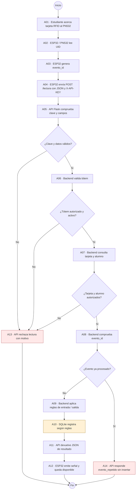

# CU-01 · Registrar asistencia con tarjeta RFID — Vista de procesos UML

**Proyecto:** Sistema MPAZ RFID · **Ficha 05** · Sección **003D**  
**Estado:** esquema documental para revisión del equipo y docente; no es una prueba de ejecución.

## Correspondencia con la ficha

- **Vista de escenarios (+1):** CU-01 · Estudiante registra asistencia presentando tarjeta ante el tótem.
- **Vista de procesos:** A01–A14, validaciones, caminos alternativos y responsables lógicos.
- **Componentes:** PN532/ESP32, API Flask, validaciones del backend, SQLite.
- **Condiciones de validación:** clave API y campos, tótem activo, tarjeta/alumno autorizado y evento no procesado.
- **Limitaciones:** un diagrama no demuestra que el recorrido completo se probó; falta correlacionar una nueva lectura con su registro persistido.

**Fuente editable DOT:** [Abrir .dot](MPAZ_RFID_Ficha05_Diagrama_Actividades_UML.dot). La [versión PNG](MPAZ_RFID_Ficha05_Diagrama_Actividades_UML.png), el [SVG](MPAZ_RFID_Ficha05_Diagrama_Actividades_UML.svg) y la [Ficha 05 Word](Ficha_Avance_05_MPAZ_RFID_003D_PARA_REVISION.docx) están subidos en la misma carpeta desde el 23-10-2026; pendientes de revisión académica.
